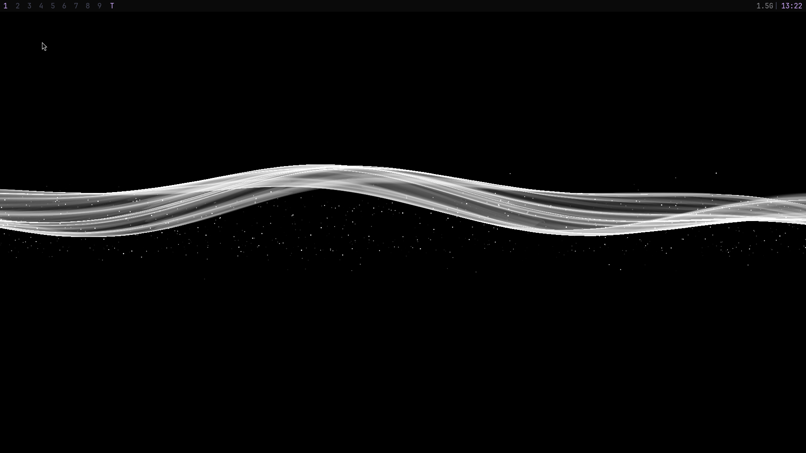
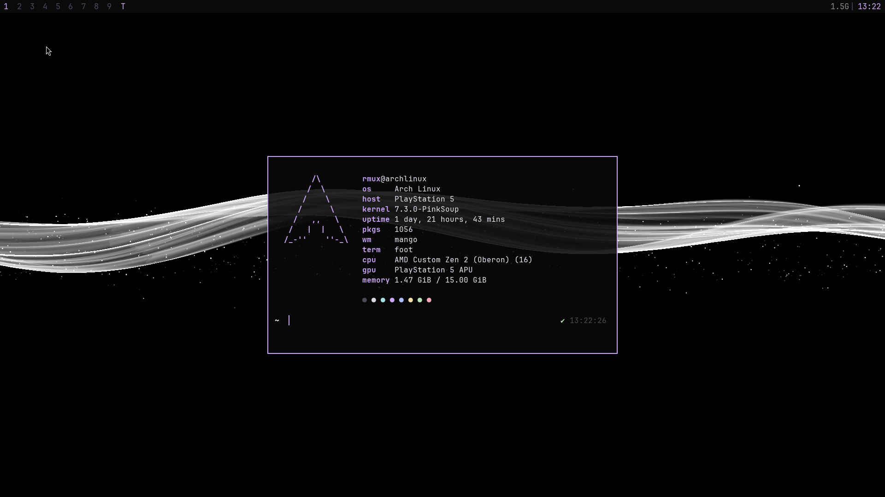
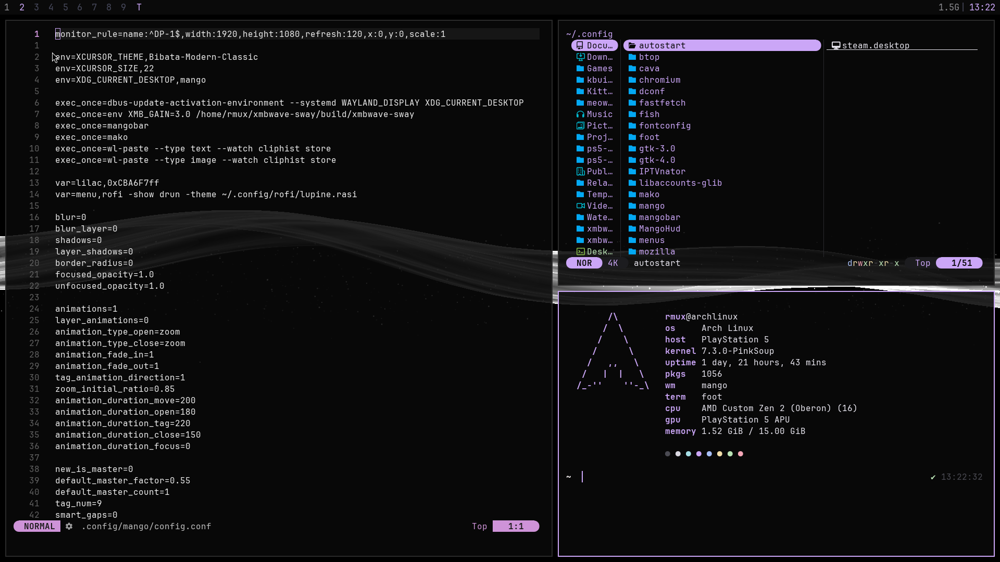
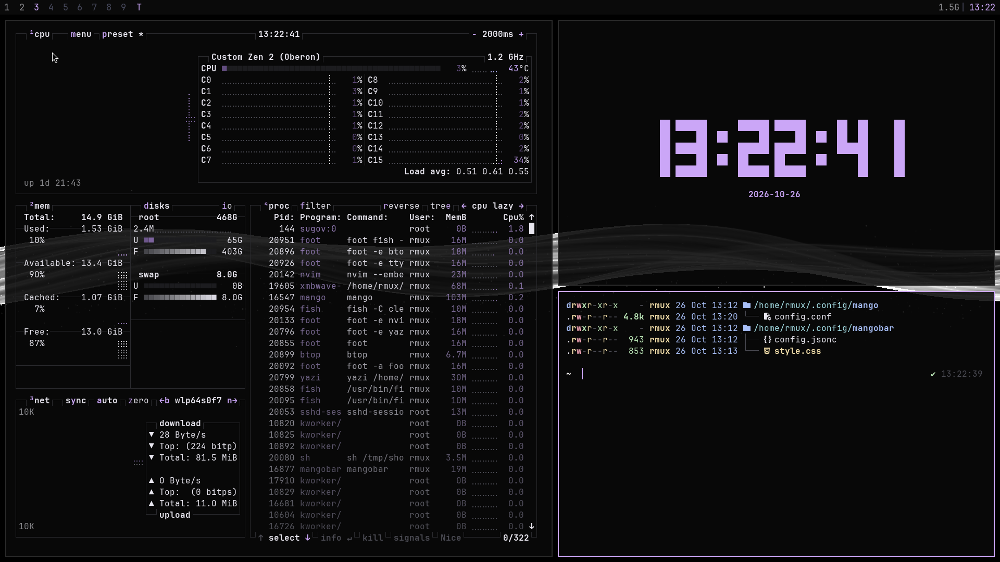
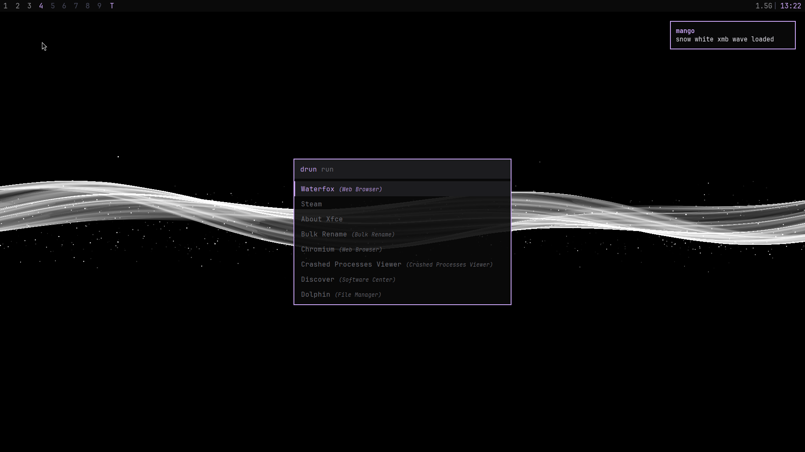

# mango-dots

Arch + mango rice. OLED black, lilac `#CBA6F7`, PS3 XMB wave as a live wallpaper. Built on a PS5 running Arch, works on any Arch box with Wayland.



| | |
|---|---|
|  |  |
|  |  |

## What is in it

| Part | Program |
|---|---|
| WM | mango (mangowm) |
| Bar | mangobar |
| Wallpaper | xmbwave-sway (in `xmbwave/`, built by the installer) |
| Terminal | foot |
| Shell | fish + tide + fzf.fish |
| Launcher | rofi (`lupine.rasi`) |
| Notifications | mako |
| Fetch | fastfetch |
| Monitor | btop (`lilac` theme) |
| Files | yazi |
| Editor | neovim |
| Visualizer | cava |
| GTK | adw-gtk3-dark + lilac accent, Breeze Dark icons, Bibata cursor |
| Font | JetBrainsMono Nerd Font |

## Install

```sh
git clone https://github.com/rmuxnet/mango-dots.git
cd mango-dots
./install.sh
```

Options:

| Flag | Effect |
|---|---|
| `--autostart` | adds `exec mango` on tty1 login to `~/.bash_profile` |
| `--skip-packages` | skips pacman and AUR, only builds the wallpaper and copies configs |

The installer:

1. Installs the repo packages with pacman.
2. Installs `mangowm-git`, `mangobar-git` and `bibata-cursor-theme-bin` from the AUR. It uses paru or yay if one is installed, else it builds them with makepkg.
3. Builds xmbwave-sway and installs it to `/usr/local/bin/xmbwave-sway`.
4. Copies everything in `config/` to `~/.config`. An existing folder is moved to `<name>.bak-<date>` first. For fish only `config.fish` and `fish_plugins` are replaced.
5. Installs fisher, fzf.fish and tide, then loads the tide colors from `fish/tide.fish`.
6. Sets the GTK theme, icons, cursor and dark mode with gsettings.

Then log in on a tty and run `mango`.

## Monitor

The config has no monitor rule, so mango uses the preferred mode. For a fixed mode add a line like this at the top of `~/.config/mango/config.conf`:

```
monitor_rule=name:^DP-1$,width:1920,height:1080,refresh:120,x:0,y:0,scale:1
```

## Wallpaper

xmbwave-sway is a layer shell port of the PS3 XMB wave (from linkev's WebGL version, MIT, see `xmbwave/LICENSE.linkev`). It renders with GLES2 at 30 fps. It reads three env vars:

| Var | Default | Meaning |
|---|---|---|
| `XMB_GAIN` | 1.0 | wave and particle brightness |
| `XMB_INK` | ffffff | wave and particle color |
| `XMB_BG` | 000000 | background color |

Presets:

| Look | Env |
|---|---|
| Snow white (default) | `XMB_GAIN=3.0` |
| Lilac on purple | `XMB_GAIN=3.0 XMB_INK=CBA6F7 XMB_BG=100B18` |
| White background, black wave | `XMB_GAIN=3.0 XMB_INK=000000 XMB_BG=ffffff` |

Change the `exec_once` line for `xmbwave-sway` in the mango config.

## Keys

| Key | Action |
|---|---|
| Super+Return | foot |
| Super+Alt+Return | floating foot |
| Alt+Space or Super+d | rofi |
| Super+q | close window |
| Super+1..9 | go to tag |
| Super+Shift+1..9 | move window to tag |
| Super+h/j/k/l or arrows | focus |
| Super+Shift+h/j/k/l | swap window |
| Super+t / s / g / o | tile / scroller / grid / monocle |
| Super+f | fullscreen |
| Super+Space | float |
| Super+m | maximize |
| Super+e | yazi |
| Super+Shift+b | btop |
| Super+v | clipboard history |
| Super+Shift+s | screenshot area (grim + slurp + satty) |
| Super+Alt+l | lock |
| Super+r | reload config |
| Super+Shift+Escape | quit mango |

## RAM

Measured on the PS5 after login:

| Process | RSS |
|---|---|
| mango | 98 MB |
| xmbwave-sway | 71 MB |
| mangobar | 20 MB |
| mako | 9 MB |
